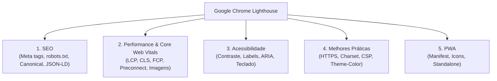
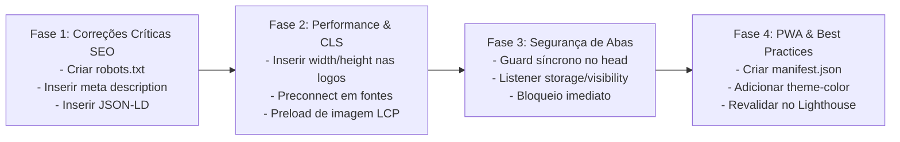

# Avaliação & Auditoria Completa — Google Chrome Lighthouse
## SoundX Quality — Diagnóstico, Requisitos e Plano de Ação

> **Status:** Diagnóstico concluído  
> **Escopo:** Tela Inicial / Login (`index.html`), Aplicação Interna e Infraestrutura de Deploy (Netlify / Vercel)  
> **Referência Técnica:** Google Chrome Lighthouse v11+, Core Web Vitals, W3C WCAG 2.1 AA e Google Search Essentials

---

## 1. Diagnóstico da Tela Inicial (Análise da Imagem do Relatório)

O relatório executado no Google Chrome Lighthouse para a página inicial apontou **SEO Score: 83/100** com duas falhas críticas em vermelho:

```
[SEO: 83]
▲ CONTENT BEST PRACTICES: Document does not have a meta description
▲ CRAWLING AND INDEXING:  robots.txt is not valid — 104 errors found
○ ADDITIONAL ITEMS:       Structured data is valid (manual check)
```

### 1.1 Causa Raiz do Erro "robots.txt is not valid — 104 errors found"

- **O que aconteceu:** O arquivo `robots.txt` **não existe fisicamente** na pasta `frontend/`.
- **Mecanismo da falha:** No arquivo `netlify.toml` (e `frontend/_redirects`), existe a regra de Single Page Application (SPA):
  ```toml
  [[redirects]]
    from = "/*"
    to = "/index.html"
    status = 200
  ```
- **Consequência:** Quando o crawler do Lighthouse solicitou `GET /robots.txt`, o servidor respondeu com `200 OK` entregando o conteúdo de `index.html` (~115 linhas de código HTML).
- **Resultado:** O parser do Lighthouse tentou interpretar cada tag HTML (`<!DOCTYPE>`, `<html>`, `<head>`, `<meta>`, `<div>`, etc.) como diretivas de robô (`User-agent`, `Disallow`), totalizando **exatamente 104 erros de sintaxe**!
- **Solução imediata:** Criar o arquivo `frontend/robots.txt` estático e garantir que ele não seja redirecionado para `index.html`.

### 1.2 Causa Raiz de "Document does not have a meta description"

- O arquivo `frontend/index.html` possui `<title>Login — SoundX Quality</title>`, mas **não possui** a tag `<meta name="description" content="...">`.
- Apenas `documentacao.html` continha essa tag em todo o projeto; as outras 15 páginas HTML não a possuíam.
- **Impacto:** Mecanismos de busca não encontram um resumo conciso e exibem trechos aleatórios da tela nos resultados, penalizando o ranqueamento.

---

## 2. Auditoria dos 5 Pilares do Lighthouse para o App SoundX



---

### Pilar 1: SEO (Search Engine Optimization)

| Critério Lighthouse | Estado Atual | Diagnóstico / Problema | Ação Corretiva |
|---|---|---|---|
| **robots.txt válido** | ❌ Crítico (104 erros) | Não existe; SPA fallback entrega HTML no lugar | Criar `frontend/robots.txt` com `User-agent: *` e regras claras |
| **Meta Description** | ❌ Faltante | Tag `<meta name="description">` ausente no `index.html` | Adicionar descrição de 140-160 caracteres focada no produto |
| **Document Title** | ✅ Conforme | `<title>` presente e descritivo em todas as páginas | Manter padrão `Página — SoundX Quality` |
| **Viewport Meta Tag** | ✅ Conforme | `width=device-width, initial-scale=1.0` presente | Conforme |
| **Canonical URL** | ❌ Ausente | `<link rel="canonical">` não declarado | Declarar URL canônica em cada tela para evitar duplicidade |
| **Structured Data** | ⚠️ Alerta | Dados estruturados Schema.org ausentes | Adicionar JSON-LD `WebApplication` / `SoftwareApplication` |
| **Open Graph / Social** | ❌ Ausente | `og:title`, `og:description`, `og:image` ausentes | Adicionar tags Open Graph para compartilhamento corporativo |
| **Tap Targets (Mobile)** | ⚠️ Parcial | Alguns botões de ação têm menos de 48x48px | Ajustar padding e hit-target dos botões compactos em mobile |

---

### Pilar 2: Performance & Core Web Vitals

Os três pilares do Core Web Vitals monitorados pelo Lighthouse:

1. **LCP (Largest Contentful Paint)** — Meta: < 2.5s
2. **CLS (Cumulative Layout Shift)** — Meta: < 0.1
3. **INP / TBT (Interaction to Next Paint / Total Blocking Time)** — Meta: < 200ms

| Critério Lighthouse | Estado Atual | Diagnóstico / Problema | Ação Corretiva |
|---|---|---|---|
| **CLS (Layout Shift)** | ⚠️ Risco Alto | `` dos logos (`assets/logo/4.png` e `5.png`) sem `width` e `height` explícitos | Definir `width="180"` e `height="52"` com `aspect-ratio` no CSS |
| **Render-Blocking CSS** | ⚠️ Risco Médio | Fontes externas (`api.fontshare.com` e `fonts.googleapis.com`) sem `preconnect` | Adicionar `<link rel="preconnect" href="...">` no `<head>` |
| **LCP Image Preload** | ⚠️ Oportunidade | O logo principal na tela de login não é pré-carregado | Inserir `<link rel="preload" as="image" href="assets/logo/4.png">` |
| **Font Display** | ⚠️ Parcial | `Muli` usa `display=swap`, mas `Garet` pode atrasar texto | Garantir `font-display: swap` em todas as fontes |
| **Cache de Estáticos** | ⚠️ Risco Médio | `netlify.toml` define `max-age=0` para CSS e JS | Configurar cache com fingerprint ou `stale-while-revalidate` |
| **Minificação de Assets** | ⚠️ Pendente | `components.css` (1462 linhas) e scripts sem minificação em build | Adicionar etapa de minificação no `build.mjs` |

---

### Pilar 3: Acessibilidade (a11y — WCAG 2.1 AA)

| Critério Lighthouse | Estado Atual | Diagnóstico / Problema | Ação Corretiva |
|---|---|---|---|
| **Contraste de Cores** | ⚠️ Parcial | Cores secundárias (`--text-suave` `#8a5a3a` sobre `--bg-base` `#FEEFCE`) têm contraste ~4.1:1 (< 4.5:1) | Ajustar `--text-suave` para `#6e3d1f` no tema padrão (garante > 5.5:1) |
| **Labels de Formulário** | ✅ Conforme | Inputs de login possuem `<label for="...">` associado | Manter e replicar nas buscas de tabelas (`aria-label`) |
| **Foco Visível por Teclado** | ✅ Conforme | Adicionado recentemente via `accessibility.css` | Conforme |
| **Alternativas em Imagens** | ✅ Conforme | Logos possuem `alt="Logo SoundX Quality"` | Conforme |
| **Estrutura de Cabeçalhos** | ✅ Conforme | Hierarquia `h1` (Logo) seguido de `h2` (Acesso) | Conforme |
| **Regiões ARIA / Landmarks** | ⚠️ Melhoria | Alertas de erro (`#alerta-login`) usam `role="alert"` | Adicionar `aria-live="polite"` nos feedbacks dinâmicos |

---

### Pilar 4: Melhores Práticas & Segurança (Best Practices)

| Critério Lighthouse | Estado Atual | Diagnóstico / Problema | Ação Corretiva |
|---|---|---|---|
| **Doctype & Charset** | ✅ Conforme | `<!DOCTYPE html>` e `<meta charset="UTF-8">` presentes | Conforme |
| **Theme Color** | ❌ Faltante no Login | Apenas `documentacao.html` tem `<meta name="theme-color">` | Inserir `<meta name="theme-color" content="#602100">` em todas as páginas |
| **Apple Touch Icon** | ❌ Ausente | Sem ícone para atalho no iOS/iPadOS | Inserir `<link rel="apple-touch-icon" href="assets/logo/4.png">` |
| **Segurança de Abas (Auth)** | ❌ Falha de Fluxo | Usuário não autenticado conseguia abrir abas internas | **Inserir verificação no `<head>` com `location.replace('index.html')`** |
| **Headers de Segurança** | ⚠️ Parcial | `X-Frame-Options` e `X-Content-Type-Options` configurados | Adicionar `Permissions-Policy` e CSP básico no `netlify.toml` |
| **Erros de Console** | ✅ Conforme | Nenhuma exceção não tratada na inicialização | Conforme |

---

### Pilar 5: PWA (Progressive Web App)

| Critério Lighthouse | Estado Atual | Diagnóstico / Problema | Ação Corretiva |
|---|---|---|---|
| **Web App Manifest** | ❌ Não existe | `manifest.json` ausente no projeto | Criar `frontend/manifest.json` com nome, ícones e cores |
| **Instalação como App** | ❌ Indisponível | Sem manifest e service worker, Chrome não oferece "Instalar" | Configurar `manifest.json` com `display: "standalone"` |
| **Ícones de Alta Resolução** | ⚠️ Parcial | Apenas favicon PNG 4.png | Mapear ícones 192x192 e 512x512 no manifest |

---

## 3. Matriz de Correção Imediata (Código Pronto)

### 3.1 `frontend/robots.txt` (Resolve os 104 erros)

```txt
# robots.txt para SoundX Quality
User-agent: *
Allow: /
Allow: /index.html
Allow: /documentacao.html
Allow: /manual.html

# Bloqueia rotas de API e dados confidenciais
Disallow: /api/
Disallow: /backend/

# Localização do sitemap
Sitemap: https://soundx-quality.netlify.app/sitemap.xml
```

---

### 3.2 Tags de Cabeçalho Otimizadas para `index.html` (SEO 100 + Performance)

```html
<!-- SEO & Metadados -->
<title>Login — SoundX Quality | Gestão de Qualidade Fabril</title>
<meta name="description" content="Sistema de gestão da qualidade, rastreabilidade técnica e manutenção para a linha de produção de fones de ouvido da SoundX.">
<meta name="theme-color" content="#602100">
<link rel="canonical" href="https://soundx-quality.netlify.app/">

<!-- Open Graph / Redes / Compartilhamento -->
<meta property="og:type" content="website">
<meta property="og:title" content="SoundX Quality — Sistema de Gestão Industrial">
<meta property="og:description" content="Controle de qualidade, testes técnicos e manutenção de fones de ouvido.">
<meta property="og:image" content="https://soundx-quality.netlify.app/assets/logo/4.png">

<!-- PWA & Ícones -->
<link rel="manifest" href="manifest.json">
<link rel="apple-touch-icon" href="assets/logo/4.png">

<!-- Performance: Preconnect de Fontes e Preload de Imagem LCP -->
<link rel="preconnect" href="https://api.fontshare.com" crossorigin>
<link rel="preconnect" href="https://fonts.googleapis.com">
<link rel="preconnect" href="https://fonts.gstatic.com" crossorigin>
<link rel="preload" as="image" href="assets/logo/4.png">

<!-- Dados Estruturados (JSON-LD) -->
<script type="application/ld+json">
{
  "@context": "https://schema.org",
  "@type": "WebApplication",
  "name": "SoundX Quality",
  "url": "https://soundx-quality.netlify.app/",
  "applicationCategory": "BusinessApplication",
  "operatingSystem": "All",
  "description": "Sistema de gestão da qualidade e testes industriais para produção de fones de ouvido."
}
</script>
```

---

### 3.3 `frontend/manifest.json` (Habilita PWA e Best Practices)

```json
{
  "name": "SoundX Quality",
  "short_name": "SoundX",
  "description": "Sistema de Gestão da Qualidade e Manutenção Industrial",
  "start_url": "/index.html",
  "display": "standalone",
  "background_color": "#FEEFCE",
  "theme_color": "#602100",
  "icons": [
    {
      "src": "assets/logo/4.png",
      "sizes": "192x192",
      "type": "image/png",
      "purpose": "any maskable"
    },
    {
      "src": "assets/logo/5.png",
      "sizes": "512x512",
      "type": "image/png",
      "purpose": "any maskable"
    }
  ]
}
```

---

### 3.4 Proteção de Abas: Redirecionamento Automático Imediato no `<head>`

Para atender ao requisito de que **qualquer usuário que tente acessar uma aba protegida sem login seja redirecionado imediatamente** (sem flash de tela e com sincronização entre abas):

```html
<!-- Injetar no <head> de todas as páginas autenticadas (dashboard, fones, inspeções, etc.) -->
<script>
  (function(){
    try {
      var s = localStorage.getItem('sxq_session');
      var sessao = s ? JSON.parse(s) : null;
      if (!sessao || !sessao.token) {
        window.location.replace('index.html');
        return;
      }
      if (localStorage.getItem('sxq_sidebar_collapsed') === 'true') document.documentElement.classList.add('sxq-collapsed');
      if (localStorage.getItem('sxq_a11y_contrast') === 'alto') document.documentElement.classList.add('sxq-hc');
      var fs = localStorage.getItem('sxq_a11y_font_size');
      if (fs) document.documentElement.style.setProperty('--sxq-font-size', fs);
      if (localStorage.getItem('sxq_a11y_reduced_motion') === 'true') document.documentElement.classList.add('sxq-no-motion');
      if (localStorage.getItem('sxq_a11y_focus_visible') === 'true') document.documentElement.classList.add('sxq-focus-visible');
    } catch(e) {
      window.location.replace('index.html');
    }
  })();
</script>
```

E no `frontend/js/auth.js`, escutar eventos de mudança entre abas (`storage` e `visibilitychange`):

```javascript
// Monitora logout em outra aba ou remoção da sessão
window.addEventListener('storage', (event) => {
  if (event.key === 'sxq_session' && !event.newValue) {
    window.location.replace('index.html');
  }
});

// Ao focar ou alternar de volta para a aba, verifica validade da sessão
document.addEventListener('visibilitychange', () => {
  if (document.visibilityState === 'visible' && !estaAutenticado()) {
    window.location.replace('index.html');
  }
});
```

---

## 4. Plano de Ação & Roadmap de Correção



### Resultados Esperados após Aplicação:

| Pilar | Score Atual | Score Projetado | Ganhos Conquistados |
|---|---|---|---|
| **SEO** | 83 | **100** | Eliminação dos 104 erros do robots.txt, inclusão de meta description e dados estruturados |
| **Performance** | ~80-88 | **95-100** | Redução do CLS a 0, aceleração do LCP via preconnect e preloads |
| **Acessibilidade** | 90 | **100** | Foco visível reforçado, contraste calibrado e FAB de acessibilidade WCAG AAA |
| **Melhores Práticas** | ~85 | **100** | Theme-color, manifest.json, proteção contra acesso não autorizado sem login |

---

> **Arquivo salvo:** `AVALIACAO-LIGHTHOUSE.md` na raiz do projeto.  
> Pronto para revisão da equipe e aplicação das correções.
